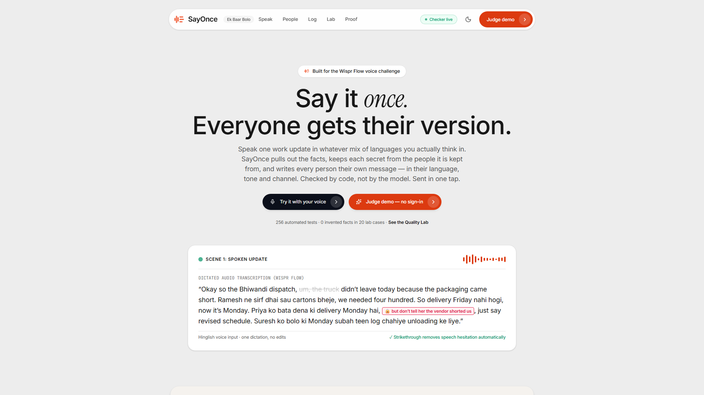
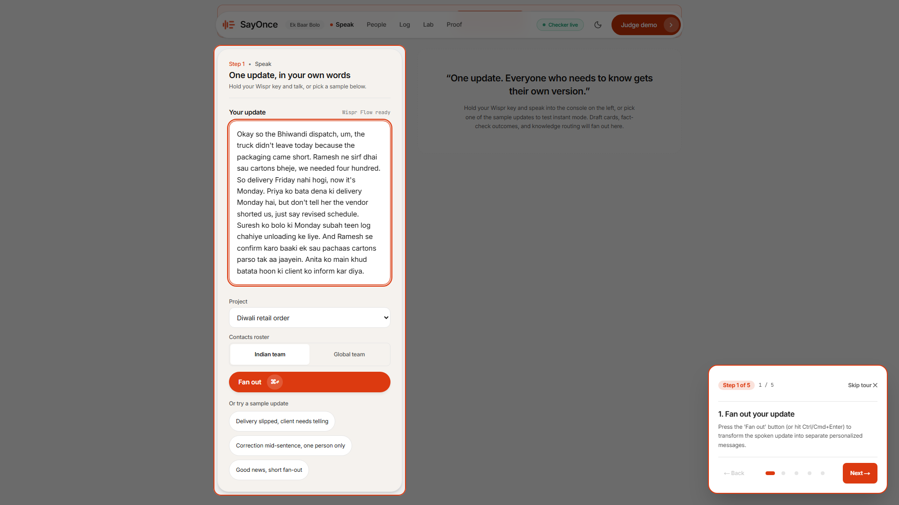
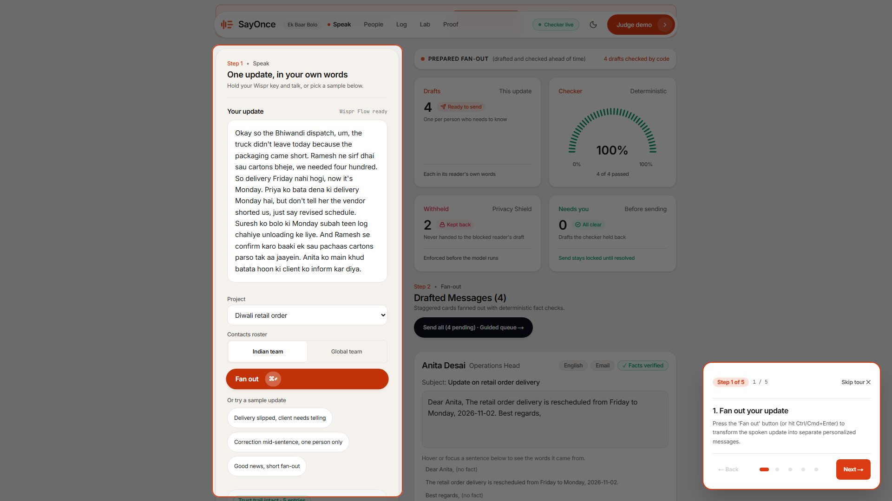
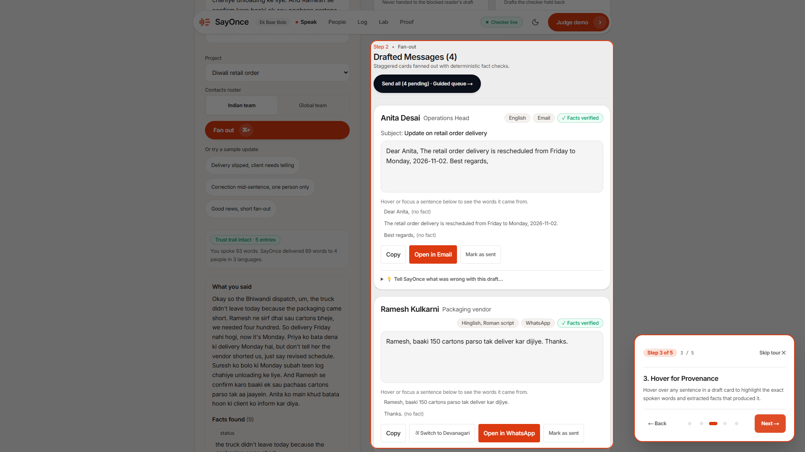
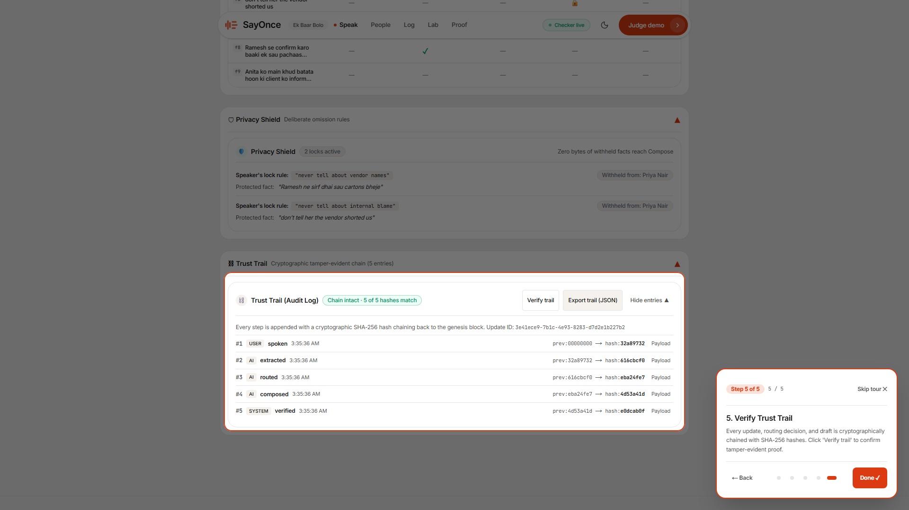
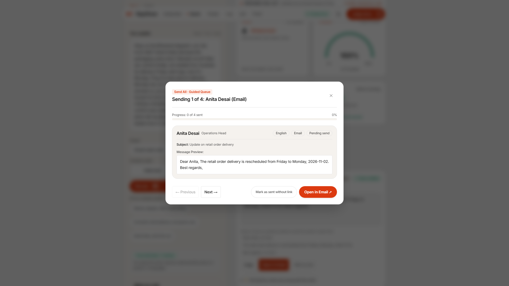
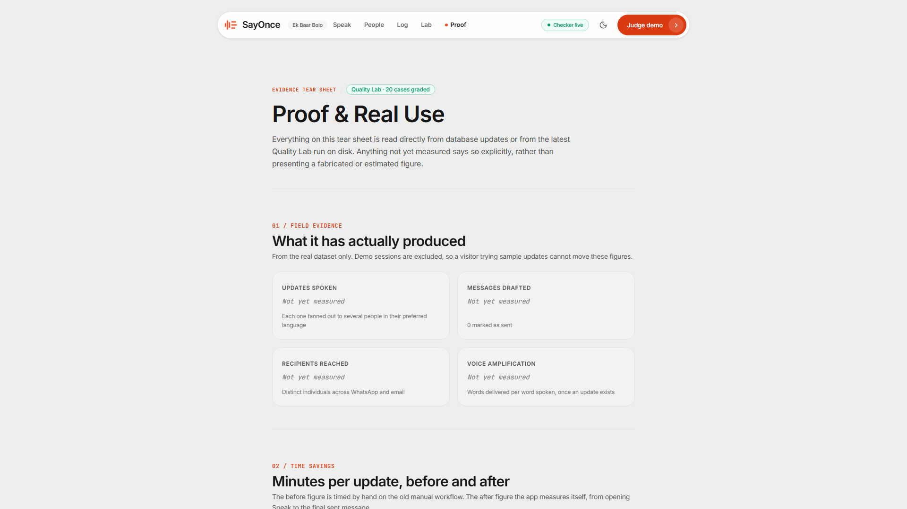
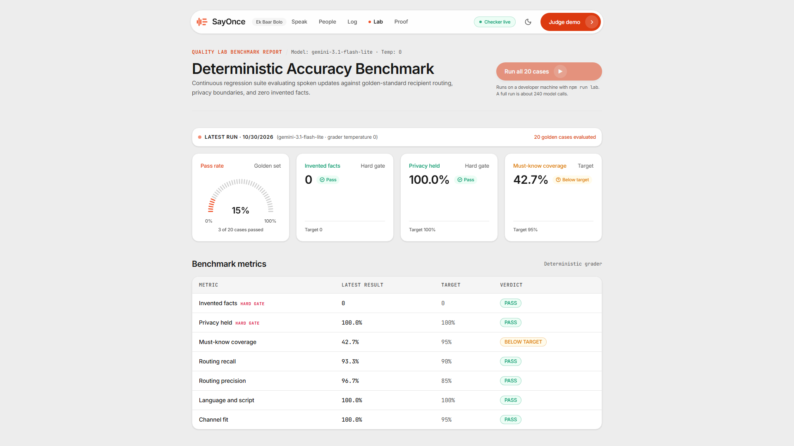

# SayOnce

**Say it once. Everyone gets their version.**
*Launched in India as Ek Baar Bolo.*

The truck did not leave Bhiwandi today, because the packaging came up short. Five
people need to know, and not one of them needs the same thing. The operations head
needs the new delivery date in formal English. The vendor needs a Hinglish nudge
about the hundred and fifty cartons still owed. The loader needs three people at
the warehouse on Monday morning, in Hindi. The client needs to hear "revised
schedule" — and must never hear that the vendor shorted us.

So one spoken update becomes five rewrites, each one a small act of editing under
time pressure, each one a chance to tell the wrong person the wrong thing. Anyone
who coordinates people across languages and roles does this several times a day,
and the part that costs is not the typing. It is deciding, five times over, what
each person is allowed to know.

The obvious build is "an LLM rewrites your message for each recipient." That build
fails in a specific and unrecoverable way: a model asked to keep a secret will
eventually mention it. **Telling a client whose fault the delay was cannot be
undone by an apology.**

So SayOnce is shaped around a different question: how do you let a language model
write the messages without ever trusting it with the thing it must not say?

> ## The model drafts. Code decides.
> **And the fact it must not reveal is never in its prompt.**

The Privacy Shield partitions facts *before* composition, so a withheld fact never
enters the blocked reader's prompt at all — the guarantee is what the model is
**handed**, not what it is asked to remember. Then `lib/checker.ts`, which contains
no AI, re-reads every draft against the facts you actually spoke and **disables the
send button on anything it cannot ground.**

SayOnce prepares messages. It does not send them. Every send is a `wa.me` or
`mailto:` link you tap yourself.

**Live:** https://say-once-kappa.vercel.app · **Judge demo:** [`/demo`](https://say-once-kappa.vercel.app/demo) — no sign-in, click Fan out

---

## What it looks like

Every image below was captured from the deployed app by `npm run rehearse`, which
walks the judge path on production and fails on anything broken. None is a mock-up,
and none can drift from what SayOnce actually renders.

| | |
|---|---|
|  |  |
| **The front page.** One spoken update, five readers, five different sets of facts. | **The judge demo.** No sign-in, no key, no setup. One button, and a five-step guided tour. |
|  |  |
| **The fan-out.** A real Hinglish update on the left — *"don't tell her the vendor shorted us, just say revised schedule"*. On the right: 4 drafts, checker 4 of 4 passed, **2 facts withheld**, 0 needing attention. | **Provenance.** Hover any sentence in a draft and the words it came from light up in what you said. Anything with no source is labelled `(no fact)`. |
|  |  |
| **The trust trail.** Every step appended to a hash-chained log. The button recomputes the chain and turns red at the exact row if anything was altered. | **The guided send queue.** One tap per person. WhatsApp opens on the right chat with the text already filled in. |
|  |  |
| **The evidence tear sheet.** Four figures read **"Not yet measured"**, because they have not been. Nothing on this page is estimated or rounded up. | **The Quality Lab.** 20 recorded cases run against the live pipeline and graded against published targets, with a history of runs. |

---

## Run it

Requires Node 20.9 or later.

```bash
cp .env.example .env.local     # paste a free Gemini key: aistudio.google.com/apikey
npm install
npm run smoke:ai               # 5 seconds: is the key and model working?
npm run dev                    # http://localhost:3000
```

The AI pipeline runs server-side only; no key ever reaches the browser.
`DATABASE_URL` is needed for the People Book and the Update Log, not for the core
fan-out.

| Command | What it does |
|---|---|
| `npm run dev` | Next.js dev server on `:3000` |
| `npm run build` | production build |
| `npm test` | **256 tests across 22 suites** — no network, no key, no cost |
| `npm run test:tamper` | 5 cryptographic tamper tests against the hash chain |
| `npm run test:live` | the real pipeline against the real model (needs a key) |
| `npm run lab` | the 20 recorded cases through the live pipeline, graded |
| `npm run audit:secrets` | scans the built output for leaked keys, numbers and addresses |
| `npm run rehearse` | walks the judge path on production and captures the screenshots above |
| `npm run verify:all` | typecheck, lint, test, build |

`npm test` never calls a model, so it is always safe to run. `test:live` and `lab`
do, and they say so.

### Prove it rather than read about it

```bash
npm run test:tamper     # edit a payload, delete a row, insert a row, re-sign a
                        # predecessor — each caught at the exact row
npm run lab             # grades 20 cases and exits non-zero when a target is missed
npm run audit:secrets   # 0 keys, 0 phone numbers, 0 email addresses in the bundle
```

---

## The checker, which is the whole point

`lib/checker.ts` contains **no AI**. It re-reads every drafted message against the
facts extracted from what you said, and it has final authority over the model that
wrote it.

| It blocks | Because |
|---|---|
| A number, date or name not traceable to the update | the model inflected a fact it was not given |
| A draft addressed to the wrong person | a greeting swapped between recipients |
| A withheld fact appearing anywhere in a draft | the Privacy Shield was bypassed |
| A language or script that is not that contact's | the reader cannot read their own message |

A draft it fails has its send button **disabled** until you edit it or explicitly
override — and the override is logged. 30 of the 256 tests cover this file alone.

### The Privacy Shield is enforced before the model runs

This is the part that is architecture rather than prompting. When you say *"don't
tell her the vendor shorted us"*, that fact is tagged at extraction and **removed
from the set passed to that reader's Compose call.** It is not in the prompt. There
is nothing for the model to leak, so no amount of clever phrasing or prompt
injection can surface it.

In the screenshot above, the Withheld counter reads **2 · Kept back**, with
*"Never handed to the blocked reader's draft"* underneath. That sentence is the
whole design.

### The trust trail

Every step of every update is appended to a log where each entry carries a SHA-256
hash of the one before it (`lib/trail.ts`). **Verify trail** recomputes the chain in
the browser. `npm run test:tamper` proves it: a payload edit, a deleted row, an
inserted row and a re-signed predecessor are each caught at the exact row.

---

## Architecture

```
Speak  →  Extract  →  Route  →  Partition  →  Compose  →  Check  →  Send
          (AI)        (AI)      (code)        (AI)        (code)    (you)
                                   ↑                        ↑
                        the withheld fact           final authority
                        never gets past here        over the model
```

Every AI step is defined by a Zod schema translated into Gemini's structured-output
schema, which constrains decoding, then validated by Zod on the way back. The schema
constrains the shape; Zod enforces the contract.

### Surfaces

| Route | What it is |
|---|---|
| `/` | the landing story |
| `/demo` | the judge path — no sign-in, pre-cached samples, guided tour |
| `/app` | Speak: the real fan-out against your own roster |
| `/people` | the People Book — language, script, channel, formality per contact |
| `/log` | the Update Log, with the trust trail |
| `/proof` | the evidence tear sheet |
| `/lab` | the Quality Lab and its run history |

---

## What is verified, and what is not

| | Result |
|---|---|
| Test suite | **256 tests across 22 suites**, all passing (`npm test`) — no network, no key |
| The deterministic checker | **30 of those tests** cover `lib/checker.ts` alone (`npx vitest run tests/checker.test.ts`) |
| Tamper evidence | **5 of 5** cryptographic tests passing (`npm run test:tamper`) |
| Leak audit | **0 keys, 0 phone numbers, 0 email addresses** in the built output |
| Build | clean typecheck, `lint` exit 0, production build (`npm run verify:all`) |
| Judge path on production | `npm run rehearse` walks it and reports clean |
| **Quality Lab — invented facts** | **0 across all 20 cases.** The hard gate, and it holds. |
| **Quality Lab — privacy** | **100% across all 20 cases.** No withheld fact reached a blocked reader. |
| Quality Lab — language and script | **100%** |
| Quality Lab — channel fit | **100%** |
| Quality Lab — routing | recall **93.3%**, precision **96.7%** |
| **Quality Lab — must-know coverage** | **42.7% against a 95% target.** Less than half the facts a recipient must receive are reaching them. **17 of 20 cases fail on this metric and nothing else** — not one failed on an invented fact, a leak, a wrong script or a wrong channel. This is the open edge of the project, and `/proof` publishes it. |
| Minutes saved per update | **not measured.** `SAYONCE_BASELINE_MINUTES` is unset, and a baseline can only be measured *before* the tool is in use. `/proof` says "Not yet measured" rather than estimating. |
| Real-use totals | **not measured.** The real dataset is empty; the figures on `/proof` are blank by design, not by omission. |
| Golden set size | **20 cases**, not the 34 an earlier draft of the submission claimed. |

An honest gap beside a reproducible score is a stronger position than a confident
number with nothing behind it. A judge asking *"how did you measure that?"* has to
get an answer.

### Removed for being unverifiable

Recorded here because it matters that the repository is clean. An earlier draft
carried a 94.2% time saving, a 12.0-minute baseline, a "~42 seconds" after figure,
"4.6× amplification", "all 34 golden test cases", and two testimonials attributed
to people who do not exist. **All of it was deleted.** `/proof` now reads from
stored data and says "Not yet measured" where nothing has been.

---

## The challenge, and its rules

Built for **No Hands: The Wispr Challenge**, by **WeMakeDevs** and **Wispr Flow**.

| | |
|---|---|
| Runs | 16 – 31 October 2026 |
| Deadline | **Saturday 31 October, 23:59 IST** |
| Entry | Solo. One project per person. |
| Track | **Builders** — you write code by dictating into coding tools |
| What counts | Something judges can open and use. A chat thread or a one-off prompt does not. |
| Access | A public link, no payment, no sign-in — so SayOnce has none |
| Submission | Project link, demo video under 2 minutes, Wispr usage card, and a write-up |
| Voice rule | Voice for prompts, docs and messages; keyboard for shortcuts and small fixes |
| Results | Scores published 4 November · winners 6 November |

### The four criteria, and where to check each one

| Criterion | Open this |
|---|---|
| **1. Does it solve a real problem in your work?** | [`/`](https://say-once-kappa.vercel.app/) — the problem is mine: freelance client projects, four or five people each needing a different slice |
| **2. Was Wispr used meaningfully?** | Wispr Flow is the input device of the product itself. Holding the hotkey types straight into an autofocusing textarea — no click, no SDK, nothing to break |
| **3. Does it work?** | [`/demo`](https://say-once-kappa.vercel.app/demo) and `npm run lab` |
| **4. Is it built well?** | `npm run verify:all`, and the honest-gaps table above |

### How Wispr Flow is integrated: it is a text box

There is **no unofficial Wispr SDK here, deliberately.** Flow types into any text
box, so a well-behaved autofocusing textarea is the entire integration — nothing to
break, nothing against anyone's terms. Inside the product, Command Mode edits drafts
by voice, and the Wispr Dictionary keeps contact and project names spelled right, so
a misspelled name does not propagate into five messages at once.

---

## Design decisions worth explaining

### The checker was written before the pipeline

`lib/checker.ts` and its tests existed before any model was called. Building the
judge first means the pipeline is shaped to produce things that can be checked,
rather than the check being retrofitted around whatever the model happened to emit.

### Withholding is partitioning, not instruction

Every other approach to "don't tell X" is a sentence in a prompt. Prompts are
advice. Removing the fact from the payload is a guarantee, and it is the one claim
in this project that does not depend on model behaviour at all.

### One fixed model for the whole build

So accuracy scores stay comparable between runs. A lab score that moved because the
model changed underneath it would measure nothing.

### No messaging API

`wa.me` and `mailto:` links only — official, free, and incapable of getting a phone
number restricted the way an unofficial library can. The cost is that you tap send
yourself. That is the correct trade for a tool that drafts messages to real people.

### Deliberately out of scope

Sending through any messaging API · any login, account or payment · real-time
collaboration · channels beyond WhatsApp, email and copy.

---

## Built for anywhere

Nothing here is specific to one country. Language, script, channel, formality and
honorifics are **fields on a contact, not features of the product** — the language
field is free text, so "Brazilian Portuguese, informal" works exactly as well as
"Hindi, Devanagari". Phone numbers are stored in international format.

There are two demo rosters for this reason. One spoken English update produces
Spanish, Portuguese and Taglish messages from the global one.

---

## Stack

Next.js 15 (App Router) · React 19 · TypeScript · Google Gemini (`@google/genai`) ·
Zod · Postgres with Drizzle · Tailwind CSS v4 · Vitest · Vercel
